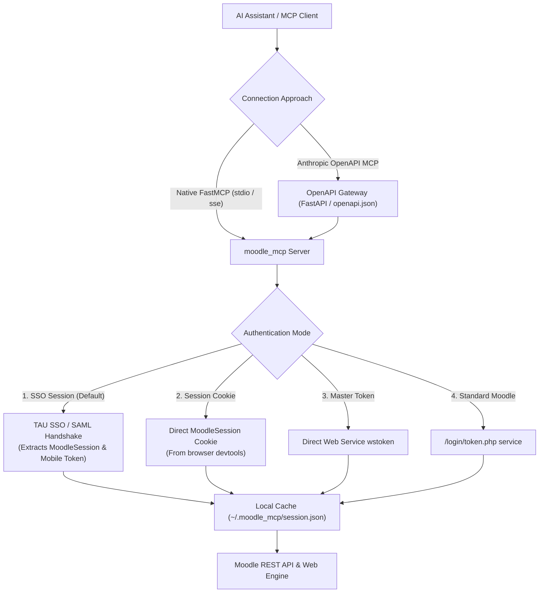

# 🎓 Moodle MCP Server & OpenAPI Bridge (`moodle_mcp`)

[](https://www.python.org/)
[](https://modelcontextprotocol.io/)
[](https://spec.openapis.org/oas/v3.1.0)
[](https://opensource.org/licenses/MIT)

A high-performance **Model Context Protocol (MCP)** server and **OpenAPI 3.1 gateway** in Python that connects LLMs and AI providers (Claude Desktop, Cursor, Antigravity, Gemini, OpenAI, Cline, Windsurf, LangChain) directly to **Moodle LMS** (specifically configured for Tel Aviv University, but adaptable to any standard Moodle).

Supports both **Native FastMCP / MCPServer** (stdio, SSE, streamable-http) and **Anthropic's OpenAPI MCP approach** (via `@ivotoby/openapi-mcp-server`, `awslabs.openapi-mcp-server`, or direct FastAPI REST endpoints).

---

## 🌟 Highlights

- 🌐 **Anthropic OpenAPI MCP Support**: Fully compliant OpenAPI 3.1 specification (`openapi.json`, `openapi.yaml`) and interactive Swagger UI (`/docs`). Instantly discoverable by any OpenAPI-to-MCP runner without custom tool adapters.
- 🔐 **Zero-Token Session Starting (Preferred)**: Connects automatically via university SSO credentials (Username + Password + Student ID) or browser session cookies—**no master token required!** Automatically establishes authenticated sessions, negotiates SAML SSO handshakes, and manages Web Service tokens behind the scenes.
- 🔑 **Master Token Tolerant**: If you already possess an active Moodle Web Service token (`wstoken`), you can pass it directly via `.env` or the `moodle_login` tool.
- 💾 **Persistent Session Caching**: Saves active session tokens and cookies securely to `~/.moodle_mcp/session.json` so AI assistants remain authenticated across restarts.
- 🔄 **Self-Healing Session Recovery**: Automatically catches token expiry or session invalidation during long conversations and transparently re-authenticates.
- ⚡ **Multi-Threaded REST Engine**: Parallelizes assignment queries and grade reports using thread pools, reducing full degree scans from 40+ seconds to ~2 seconds.
- 📚 **Full Academic Access**:
  - **Courses**: Enrolled courses with semester, group, and academic year classification.
  - **Assignments & Deadlines**: True Deadline calculation considering nominal due dates, strict cutoff dates, and individual student extensions.
  - **Submissions**: Uploads solutions (PDF, ZIP, code) via multipart API or enters online text responses with draft/grading safety flags.
  - **Quizzes & Tests**: Active and upcoming course quizzes, open/close windows, time limits, and attempt rules.
  - **Academic Calendar**: Aggregated upcoming deadlines, exam dates, and scheduled classes in one call.
  - **Course Announcements**: Live updates and notices posted by instructors on news and discussion forums.
  - **Course Participants**: Teachers, teaching assistants (TAs), and contact emails.
  - **Grades & GPA**: Gradebook items, formatted scores, percentages, and course average summaries.
  - **Course Materials**: Section-by-section file listings and download proxy.
  - **In-Memory Document Reader**: Downloads and parses PDFs (via PyMuPDF), Markdown, TXT, and HTML into AI context on-the-fly without saving to disk.
  - **Zoom & Meetings**: Automatically extracts live class links and recurring meeting schedules.
  - **Panopto Recordings**: Discovers lecture videos and recitation (*tirgul*) recordings.
  - **Global Search**: Instant fuzzy/keyword search across all courses, tasks, files, and lectures.

---

## 📋 Table of Contents

1. [Architecture & Auth Modes](#-architecture--auth-modes)
2. [Anthropic's OpenAPI MCP Approach](#-anthropics-openapi-mcp-approach)
3. [Installation](#-installation)
4. [Configuration (.env)](#-configuration-env)
5. [Connecting AI Providers](#-connecting-ai-providers)
   - [Google Gemini (Native Agent & Function Calling)](#1-google-gemini-native-agent--function-calling)
   - [Claude Desktop (Native MCP)](#2-claude-desktop-native-mcp)
   - [Claude Desktop (OpenAPI MCP Approach)](#3-claude-desktop-openapi-mcp-approach)
   - [Cursor IDE](#4-cursor-ide)
   - [Antigravity](#5-antigravity)
   - [AWS Labs OpenAPI MCP Server](#6-aws-labs-openapi-mcp-server)
   - [Cline / Roo Code / Windsurf](#7-cline--roo-code--windsurf)
   - [Docker & Homelab Deployment](#8-docker--homelab-deployment)
   - [Python / LangChain / OpenAI](#9-python--langchain--openai)
6. [Tool Reference](#-tool-reference)
7. [Resources & Prompts](#-resources--prompts)
8. [CLI Options](#-cli-options)

---

## 🔐 Architecture & Auth Modes



### 1. Zero-Token Session Starting (Recommended)
You only need to supply your SSO credentials in `.env` (or pass them via the `moodle_login` tool):
- `MOODLE_USERNAME`: Your university SSO username.
- `MOODLE_PASSWORD`: Your password.
- `MOODLE_STUDENT_ID`: Your 9-digit Israeli ID / Student ID.

The server initiates a headless SAML session handshake with `https://nidp.tau.ac.il`, logs in, accepts assertions, obtains an active `MoodleSession`, resets/retrieves an active mobile Web Service token via `/user/managetoken.php`, and caches it locally.

### 2. Browser Session Cookie
If you prefer not to enter credentials, copy the value of your `MoodleSession` cookie from your browser devtools (Storage -> Cookies -> `moodle.tau.ac.il`):
```bash
MOODLE_SESSION_COOKIE=abc123xyz...
```

### 3. Master Web Service Token (`wstoken`)
If you already have an active Moodle Web Service token:
```bash
MOODLE_TOKEN=your_32_character_token_here
```

---

## 🌐 Anthropic's OpenAPI MCP Approach

Anthropic's Model Context Protocol supports bridging standard REST APIs directly into AI models using **OpenAPI specifications**. This gives you full flexibility to run `moodle_mcp` through any OpenAPI runner without custom client coding.

### 1. Start the OpenAPI REST Gateway

```bash
# Starts the FastAPI OpenAPI gateway on port 8000
python -m moodle_mcp --mode openapi --port 8000
```
- **Interactive Swagger UI**: `http://localhost:8000/docs`
- **ReDoc Documentation**: `http://localhost:8000/redoc`
- **Live OpenAPI 3.1 Spec**: `http://localhost:8000/openapi.json`

### 2. Connect via OpenAPI MCP Runner (`@ivotoby/openapi-mcp-server`)

Add to your `claude_desktop_config.json`:
```json
{
  "mcpServers": {
    "moodle-openapi": {
      "command": "npx",
      "args": [
        "-y",
        "@ivotoby/openapi-mcp-server",
        "http://localhost:8000/openapi.json"
      ]
    }
  }
}
```

### 3. Connect via AWS Labs OpenAPI MCP Server

```json
{
  "mcpServers": {
    "moodle-openapi": {
      "command": "uvx",
      "args": [
        "awslabs.openapi-mcp-server@latest",
        "--spec",
        "https://raw.githubusercontent.com/duck-5/moodle-mcp/main/openapi.json"
      ]
    }
  }
}
```

### 4. Export Static OpenAPI Files

You can export the OpenAPI specification at any time:
```bash
python -m moodle_mcp --export-openapi .
```
This generates `openapi.json` and `openapi.yaml` in the current directory.

---

## 🚀 Installation

Ensure Python 3.10+ is installed:

```bash
# Clone the repository
git clone https://github.com/duck-5/moodle-mcp.git
cd moodle-mcp

# Install dependencies
pip install -r requirements.txt

# Or install as an editable package
pip install -e .
```

Verify your installation:
```bash
python -m moodle_mcp --status
```

---

## ⚙️ Configuration (.env)

Create a `.env` file in the root of the project (copy from `.env.example`):

```bash
# Base URL of your Moodle instance
MOODLE_URL=https://moodle.tau.ac.il

# Option 1: Zero-Token SSO Session Starting (Recommended)
MOODLE_USERNAME=your_username
MOODLE_PASSWORD=your_password
MOODLE_STUDENT_ID=123456789

# Option 2: Master Web Service Token (Optional)
# MOODLE_TOKEN=your_moodle_web_service_token

# Option 3: Browser Session Cookie (Optional)
# MOODLE_SESSION_COOKIE=your_session_cookie

# Timezone (defaults to Asia/Jerusalem)
TIMEZONE=Asia/Jerusalem
```

---

## 🤖 Connecting AI Providers

### 1. Google Gemini (Native Agent & Function Calling)

`moodle_mcp` includes native support for Google Gemini via the official `google-genai` SDK and dynamic function calling. Gemini connects to your Moodle session, inspects course contents, evaluates assignment deadlines, and queries your grades.

#### Setup:
1. Obtain an API key from [Google AI Studio](https://aistudio.google.com/app/apikey).
2. Add your key to `.env`:
   ```bash
   GEMINI_API_KEY=AIzaSy...
   GEMINI_MODEL=gemini-2.5-flash
   ```

#### Interactive Chat Mode:
Start an interactive terminal conversation where Gemini automatically invokes Moodle tools:
```bash
# Using CLI entrypoint
python -m moodle_mcp --mode gemini

# Or using console script
moodle-mcp-gemini
```

Example interaction:
```
🎓 Moodle Gemini Assistant — Active (Model: gemini-2.5-flash)
Connected to Moodle instance: https://moodle.tau.ac.il

👤 You: What assignments are due in the next 10 days?
🤖 Gemini is thinking...
You have 2 pending assignments due within the next 10 days:
1. Introduction to Quantum Mechanics — Problem Set 3
   • Due: Sunday, Nov 2, 23:59 (4 days remaining)
   • Status: Not submitted
2. Operating Systems — Assignment 2 (Thread Pools)
   • Due: Thursday, Nov 6, 23:59 (8 days remaining)
   • Status: Draft saved
```

#### Single Query CLI Mode:
Ask a single question and receive an immediate answer:
```bash
python -m moodle_mcp --mode gemini --prompt "Summarize my grades across all courses"
```

#### Programmatic Python Usage:
```python
from moodle_mcp.gemini_client import MoodleGeminiAgent

agent = MoodleGeminiAgent()
response = agent.query_once("What are my deadlines this week?")
print(response)
```

---

### 2. Claude Desktop (Native MCP)

Add `moodle` to your `claude_desktop_config.json`:

- **Windows**: `%APPDATA%\Claude\claude_desktop_config.json`
- **macOS**: `~/Library/Application Support/Claude/claude_desktop_config.json`
- **Linux**: `~/.config/Claude/claude_desktop_config.json`

```json
{
  "mcpServers": {
    "moodle": {
      "command": "python",
      "args": [
        "-m",
        "moodle_mcp"
      ],
      "env": {
        "MOODLE_URL": "https://moodle.tau.ac.il",
        "MOODLE_USERNAME": "your_username",
        "MOODLE_PASSWORD": "your_password",
        "MOODLE_STUDENT_ID": "123456789"
      }
    }
  }
}
```

Restart Claude Desktop, and click the 🔨 hammer icon to see all Moodle tools!

---

### 3. Claude Desktop (OpenAPI MCP Approach)

Start the OpenAPI server (`python -m moodle_mcp --mode openapi --port 8000`) and configure:

```json
{
  "mcpServers": {
    "moodle": {
      "command": "npx",
      "args": [
        "-y",
        "@ivotoby/openapi-mcp-server",
        "http://localhost:8000/openapi.json"
      ]
    }
  }
}
```

---

### 4. Cursor IDE

In Cursor, go to **Settings** -> **Features** -> **MCP**, or edit `.cursor/mcp.json`:

```json
{
  "mcpServers": {
    "moodle": {
      "command": "python",
      "args": ["-m", "moodle_mcp"]
    }
  }
}
```

---

### 5. Antigravity

In your Antigravity project configuration:

```json
{
  "mcpServers": {
    "moodle": {
      "command": "python",
      "args": ["-m", "moodle_mcp"]
    }
  }
}
```

---

### 6. AWS Labs OpenAPI MCP Server

```json
{
  "mcpServers": {
    "moodle": {
      "command": "uvx",
      "args": [
        "awslabs.openapi-mcp-server@latest",
        "--spec",
        "openapi.json"
      ]
    }
  }
}
```

---

### 7. Cline / Roo Code / Windsurf

Configure in `cline_mcp_settings.json`:
```json
{
  "mcpServers": {
    "moodle": {
      "command": "python",
      "args": ["-m", "moodle_mcp"],
      "disabled": false,
      "autoApprove": [
        "moodle_get_enrolled_courses",
        "moodle_get_upcoming_assignments",
        "moodle_get_grades_summary",
        "moodle_get_calendar_events",
        "moodle_search"
      ]
    }
  }
}
```

---

### 8. Docker & Homelab Deployment

Deploy `moodle_mcp` as a zero-trust container attached to `mcp-gateway-net` and exposed via Cloudflare Tunnel:

```bash
# Build and start in background
docker compose up -d

# Check health status
docker compose ps
curl http://localhost:8000/health
```

#### Run Gemini Agent Inside Docker:
```bash
docker compose exec moodle-mcp python -m moodle_mcp --mode gemini
```

#### Cloudflare Tunnel Exposure:
Point your Cloudflare Tunnel hostname (`moodle.yourdomain.com`) to:
`http://moodle-mcp:8000`

This instantly provides:
- Live Swagger UI at `https://moodle.yourdomain.com/docs`
- OpenAPI Specification at `https://moodle.yourdomain.com/openapi.json` for Vertex AI Extensions or external LLMs.

---

### 9. Python / LangChain / OpenAI

Run the server over SSE or streamable-http for networked AI agents:

```bash
# Start SSE server on port 8000
python -m moodle_mcp --transport sse --port 8000
```

Connect using the Python MCP client:
```python
from mcp.client.sse import sse_client
from mcp import ClientSession

async with sse_client("http://localhost:8000/sse") as (read, write):
    async with ClientSession(read, write) as session:
        await session.initialize()
        tools = await session.list_tools()
        print("Available tools:", [t.name for t in tools.tools])
```

---

## 🛠️ Tool Reference

| Tool Name | Description | Key Arguments |
| :--- | :--- | :--- |
| `moodle_login` | Start session via SSO, cookie, standard credentials, or master token | `auth_type`, `username`, `password`, `student_id`, `token`, `session_cookie` |
| `moodle_logout` | Invalidate session and wipe local session cache | *(None)* |
| `moodle_get_status` | Check authentication status, user ID, and active profile | *(None)* |
| `moodle_get_user_profile` | Get full Moodle profile details of current student | *(None)* |
| `moodle_get_enrolled_courses` | List all enrolled courses with semester & code breakdown | `semester` (optional) |
| `moodle_get_course_contents` | Retrieve full syllabus, sections, modules, and resources | `course_id` |
| `moodle_get_course_participants` | Discover lecturers, teaching assistants (TAs), and contacts | `course_id` |
| `moodle_get_course_announcements` | Retrieve official instructor news and forum announcements | `course_id` (optional) |
| `moodle_get_assignments` | List all assignments with calculated **True Deadlines** | `course_id`, `status_filter` |
| `moodle_get_upcoming_assignments` | Pending assignments due in the next N days (default: 7) | `days_ahead` (int, default: 7) |
| `moodle_get_assignment_status` | Detailed submission info, attempts, feedback & attachments | `assignment_id` |
| `moodle_submit_assignment` | Upload solution file and/or enter online text response | `assignment_id`, `file_path`, `online_text`, `submit_for_grading` |
| `moodle_get_quizzes` | List online quizzes, exam windows, time limits, and attempts | `course_id` (optional) |
| `moodle_get_calendar_events` | Aggregated upcoming academic events, exams, and deadlines | `days_ahead` (int, default: 14) |
| `moodle_get_grades` | Get per-assignment and course-total grades and percentages | `course_id` (optional) |
| `moodle_get_grades_summary` | Summary of course averages, GPA progress, and graded counts | *(None)* |
| `moodle_get_course_files` | List all downloadable course files, slides, and handouts | `course_id`, `section_name` |
| `moodle_download_file` | Download a course file from Moodle to local storage | `file_url`, `output_directory` |
| `moodle_read_file_content` | **In-memory document reader** (PDF, TXT, MD, HTML) for direct AI context | `file_url`, `max_chars` (default: 15,000) |
| `moodle_get_course_meetings` | Discover live Zoom links and recurring lecture schedules | `course_id` (optional) |
| `moodle_get_recordings` | List Panopto lecture recordings and recitation (*tirgul*) videos | `course_id` (optional) |
| `moodle_search` | Global search across courses, tasks, files, meetings, and videos | `query`, `search_types` |
| `moodle_save_data` | Save curated data, notes, or filtered outputs under a custom key across sessions | `key`, `data`, `description` |
| `moodle_load_data` | Retrieve previously saved data by key name from persistent storage | `key` |
| `moodle_list_saved_data` | List all saved items, keys, descriptions, and timestamps | *(None)* |
| `moodle_delete_saved_data` | Delete a specific saved data item from storage | `key` |
| `moodle_clear_cache` | Clear automatic Moodle API response cache or specific category | `category` (optional) |
| `moodle_get_cache_status` | View cache hit statistics, entry ages, and file storage status | *(None)* |

---

## 📦 Resources & Prompts

### Resources
- `moodle://profile`: Current user details and Moodle site configuration.
- `moodle://courses`: Real-time list of enrolled courses.
- `moodle://upcoming`: Chronological list of deadlines in the next 7 days.
- `moodle://grades`: Summary of course grades and averages.
- `moodle://quizzes`: Active and upcoming course quizzes.
- `moodle://calendar`: Academic calendar events for the next 14 days.
- `moodle://announcements`: Course announcements and forum notices.
- `moodle://saved`: Metadata list of all named items in persistent storage.
- `moodle://cache`: Status and entry ages of the automatic API cache.

### Prompts
- `study_briefing`: Summarizes current courses, upcoming deadlines, and study priorities.
- `assignment_analysis`: Inspects assignment instructions, parses attached PDFs, and outlines requirements and completion steps.
- `exam_preparation`: Analyzes course syllabus, upcoming exam dates, past materials, and announcements for targeted exam preparation.

---

## 💻 CLI Options

```bash
# Check current authentication status
python -m moodle_mcp --status

# Interactive SSO login CLI (prompts for password securely)
python -m moodle_mcp --login-sso

# Interactive Gemini AI assistant with real-time Moodle tool calling
python -m moodle_mcp --mode gemini

# One-off Gemini question from terminal
python -m moodle_mcp --mode gemini --prompt "What deadlines do I have next week?"

# Run standard stdio MCP server (for Claude Desktop, Cursor, Antigravity)
python -m moodle_mcp --transport stdio

# Run SSE server for network / remote AI agents
python -m moodle_mcp --transport sse --port 8000 --host 0.0.0.0

# Run streamable-http MCP server
python -m moodle_mcp --transport streamable-http --port 8000

# Run FastAPI OpenAPI REST Gateway (Anthropic OpenAPI approach)
python -m moodle_mcp --mode openapi --port 8000

# Export static OpenAPI 3.1 specification (openapi.json and openapi.yaml)
python -m moodle_mcp --export-openapi .
```

---

## 🛡️ Security & Privacy

1. **Client-Only Architecture**: `moodle_mcp` communicates directly from your machine to Moodle. No third-party servers, relays, or cloud proxies are involved.
2. **Encrypted at Rest**: Persistent sessions in `~/.moodle_mcp/session.json` reside strictly on your local disk in your user profile.
3. **Draft Safety**: `moodle_submit_assignment` defaults to saving files as drafts (`submit_for_grading=False`), preventing accidental locking of assignments before you verify them.
4. **Git Protection**: Strict `.gitignore` ensures credentials, tokens, and session caches are never committed to version control.

---

## 📄 License

MIT License. See [LICENSE](LICENSE) for details.
