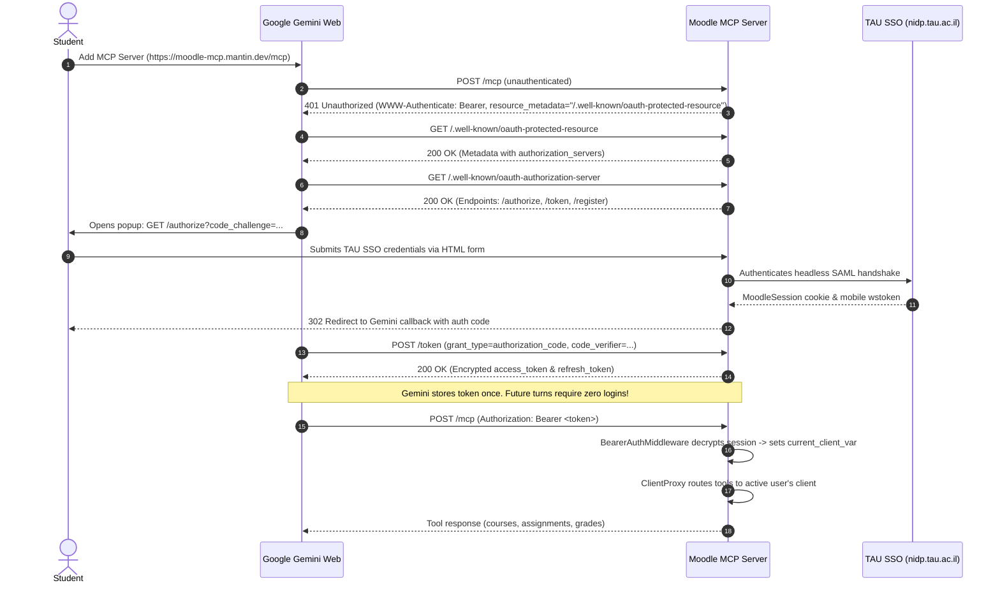

# `moodle_mcp` Architecture & Design

`moodle_mcp` is a Model Context Protocol (MCP) server that connects Large Language Model (LLM) agents, copilots, and AI providers directly to Tel Aviv University's Moodle learning management system.

---

## 1. System Architecture

```mermaid
graph TD
    Client[AI Client: Claude Desktop / Cursor / Antigravity / Cline] -->|stdio or SSE / JSON-RPC| Server[server.py - MCPServer / FastMCP]
    
    subgraph moodle_mcp Server
        Server --> Router[Tools & Resources Dispatcher]
        Router --> AuthTools[tools/auth_tools.py]
        Router --> CourseTools[tools/courses_tools.py]
        Router --> AssignTools[tools/assignments_tools.py]
        Router --> GradeTools[tools/grades_tools.py]
        Router --> FileTools[tools/files_tools.py]
        Router --> MeetingTools[tools/meetings_tools.py]
        Router --> RecTools[tools/recordings_tools.py]
        Router --> SearchTools[tools/search_tools.py]
        
        AuthTools & CourseTools & AssignTools & GradeTools & FileTools & MeetingTools & SearchTools --> ClientEngine[client.py - MoodleClient]
        AuthTools --> AuthEngine[auth.py - MoodleAuth]
        RecTools --> PanoptoEngine[panopto.py - PanoptoScraper]
        
        AuthEngine --> Cache[(~/.moodle_mcp/session.json)]
    end

    AuthEngine -->|Zero-Token SAML Handshake| SSO[TAU SSO nidp.tau.ac.il]
    AuthEngine -->|Scrape/Reset wstoken| MoodleWeb[moodle.tau.ac.il/user/managetoken.php]
    ClientEngine -->|Parallel REST Calls (ThreadPoolExecutor)| MoodleWS[moodle.tau.ac.il/webservice/rest/server.php]
    ClientEngine -->|In-Memory PyMuPDF Document Reader| MoodleFiles[moodle.tau.ac.il/pluginfile.php]
```

---

## 2. Key Modules & Responsibilities

### `server.py`
- Initializes the MCP server using `FastMCP` (with fallback to `MCPServer` depending on `mcp` library version).
- Registers all 18 tools, 4 dynamic resources, and 2 prompt templates.
- Provides CLI entry point with flags:
  - `--status`: Check connection state and current user without starting stdio server.
  - `--login-sso`: Run interactive/automated SSO login.
  - `--transport stdio|sse`: Select communication transport.
  - `--port`: Port for SSE transport (default: 8000).

### `auth.py`
- Implements the complete SAML 2.0 WebSSO handshake against `nidp.tau.ac.il`.
- Implements `/user/managetoken.php` parsing, isolating `Moodle mobile web service` from auxiliary tokens, and resetting `wstoken`.
- Manages session lifecycle and serialization to `~/.moodle_mcp/session.json`.

### `client.py`
- Parallelized Moodle REST client.
- Uses `concurrent.futures.ThreadPoolExecutor(max_workers=8)` to query assignments and grades across dozens of courses concurrently (reducing query latency from 40+ seconds to ~2 seconds).
- Computes True Deadlines ($\max(\text{due}, \text{cutoff}, \text{extension})$).
- Parses documents directly in-memory using PyMuPDF (`fitz`) and BeautifulSoup without writing temporary files to disk.

### `oauth.py` (OAuth 2.1 & Stateless Dynamic Session Isolation)
- **RFC Compliance**: Compliant with RFC 8414 (Authorization Server Metadata), RFC 9470 (OAuth Protected Resource Metadata), RFC 7636 (PKCE), and RFC 7591 (Dynamic Client Registration).
- **Multi-User Isolation**: Enables multiple users to connect to the exact same MCP server URL (`/mcp` or `https://moodle-mcp.mantin.dev/mcp`) in Google Gemini Web / Claude.
- **`TokenManager`**: Uses AES-128 / Fernet symmetric encryption to encapsulate Moodle session credentials and cookies inside the Bearer token payload. Eliminates persistent server-side session databases while providing seamless self-healing re-authentication if TAU SSO expires.
- **`ClientProxy`**: Transparent dynamic proxy wrapping `MoodleClient`. Automatically inspects `current_client_var` (`contextvars.ContextVar`) for each incoming HTTP request, dynamically routing tool calls to the requesting user's client, while seamlessly falling back to `.env` default client in stdio mode.
- **`BearerAuthMiddleware`**: ASGI middleware verifying `Authorization: Bearer <token>`, managing request context variables, and issuing 401 challenges with `WWW-Authenticate` discovery metadata on unauthenticated requests.

### `storage.py` (In-Memory Cache & DataStore)
- In-memory TTL `CacheManager` to eliminate redundant API calls during reasoning turns without writing `cache.json` to disk.
- In-memory `DataStore` compatibility stub for temporary session notes, delegating persistent long-term storage to Google Docs / Gemini Workspace integrations.

### `tools/`
Modular tool definitions registered with the MCP server:
1. `dashboard_tools.py`: `moodle_get_dashboard` (one-call academic cockpit).
2. `courses_tools.py`: `moodle_get_enrolled_courses`, `moodle_get_course_contents`.
3. `assignments_tools.py`: `moodle_get_assignments`, `moodle_get_upcoming_assignments`, `moodle_get_assignment_status`, `moodle_submit_assignment`.
4. `grades_tools.py`: `moodle_get_grades`, `moodle_get_grades_summary`.
5. `files_tools.py`: `moodle_get_course_files`, `moodle_download_file`, `moodle_read_file_content`.
6. `quizzes_tools.py`: `moodle_get_quizzes`.
7. `calendar_tools.py`: `moodle_get_calendar_events`.
8. `search_tools.py`: `moodle_search`.
9. `additional_tools.py`: `moodle_additional_tools` (dispatcher for announcements, participants, meetings, recordings, cache, etc.).

---

## 3. OAuth 2.1 Multi-User Flow



---

## 4. Resources & Prompts

### Dynamic Resources
- `moodle://profile`: Summary of the student's identity, email, and campus metadata.
- `moodle://courses`: JSON representation of all currently enrolled courses.
- `moodle://upcoming`: List of assignments due in the next 7 days.
- `moodle://grades`: GPA breakdown and graded assignment scores.
- `moodle://quizzes`: Upcoming online tests and quiz deadlines.
- `moodle://calendar`: Academic calendar events for the next 14 days.
- `moodle://announcements`: Course announcements and discussion forum updates.
- `moodle://cache`: Statistics and status of the in-memory response cache.

### Prompt Templates
- `study_briefing`: Generates a prioritized executive briefing of upcoming tasks, meetings, and deadlines.
- `assignment_analysis`: Performs deep AI analysis of an assignment handout, extracting key deliverables and breaking them into actionable milestones.
- `exam_preparation`: Organizes revision, past materials, and announcements for an upcoming exam.
