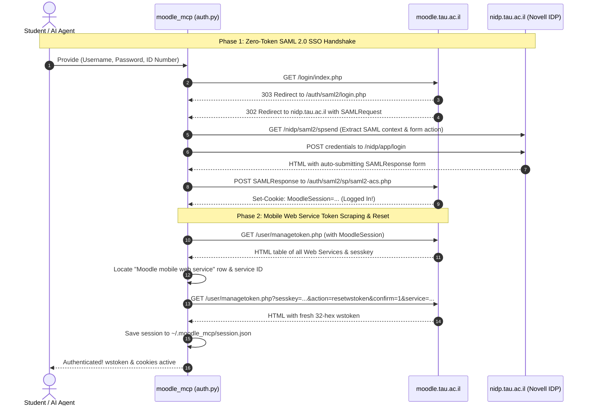

# Tel Aviv University SSO & Moodle Authentication Guide

This guide details the end-to-end authentication mechanisms implemented in `moodle_mcp`, specifically focusing on **Zero-Token Session Starting** via Tel Aviv University's SAML 2.0 WebSSO infrastructure and automatic Web Service token provisioning.

---

## 1. Authentication Architecture Overview



---

## 2. Phase 1: The SAML 2.0 WebSSO Handshake

Tel Aviv University delegates authentication to a Novell Access Manager Identity Provider (`nidp.tau.ac.il`) using standard SAML 2.0.

### Step 1: Initiate Login
The client sends an HTTP `GET` to:
```
https://moodle.tau.ac.il/login/index.php
```
Moodle redirects (HTTP 303/302) to the SAML Service Provider endpoint:
```
https://moodle.tau.ac.il/auth/saml2/login.php
```
This endpoint constructs an XML `<samlp:AuthnRequest>` and redirects to the Identity Provider:
```
https://nidp.tau.ac.il/nidp/saml2/spsend?sid=0
```

### Step 2: Extract SAML Context & Form Parameters
When loading the IDP page, an HTML form is returned. The client must extract **all** hidden `<input>` parameters and the form `action` URL.

Crucial hidden fields often include:
- `sid`: Session ID.
- `RelayState`: Target URL to return to after login.
- `SAMLRequest`: Base64-encoded authentication request.

### Step 3: Post Student Credentials
The form targets `https://nidp.tau.ac.il/nidp/app/login?sid=0...`. The client posts:
```http
POST /nidp/app/login?sid=0 HTTP/1.1
Host: nidp.tau.ac.il
Content-Type: application/x-www-form-urlencoded

Ecom_User_ID=student_username&Ecom_Password=student_password&Ecom_User_Pid=123456789&option=credential
```
*Note: For TAU students, `Ecom_User_Pid` is the 9-digit Israeli Teudat Zehut (ID number).*

### Step 4: Handle SAML Assertion (ACS Endpoint)
If the credentials are valid, the IDP responds with an HTML page containing an auto-submitting form:
```html
<form method="POST" action="https://moodle.tau.ac.il/auth/saml2/sp/saml2-acs.php">
    <input type="hidden" name="SAMLResponse" value="PHNhbWxwOlJlc3BvbnNl..." />
    <input type="hidden" name="RelayState" value="..." />
</form>
```
The client extracts `SAMLResponse` and `RelayState` and sends a `POST` request to `https://moodle.tau.ac.il/auth/saml2/sp/saml2-acs.php`.

Moodle validates the SAML cryptographic assertion and responds with the session cookie:
```http
Set-Cookie: MoodleSession=abc123xyz456...; path=/; domain=moodle.tau.ac.il; secure; HttpOnly
```

---

## 3. Phase 2: Web Service Token Extraction & Disambiguation

Once a valid `MoodleSession` cookie is established, the client can access web pages as an authenticated user, but REST API calls require a Web Service token (`wstoken`).

### Navigating to Token Management
The user's security token management interface is located at:
```
https://moodle.tau.ac.il/user/managetoken.php
```

### The Multi-Service Disambiguation Trap

Moodle instances at universities frequently enable multiple Web Service plugins. At TAU, `/user/managetoken.php` renders a table with multiple rows, such as:

| Service Name | Token | Reset Link |
| :--- | :--- | :--- |
| `mod_debate` | `...` | `action=resetwstoken&service=1` |
| `ForumNG` | `...` | `action=resetwstoken&service=2` |
| `Quickmail` | `...` | `action=resetwstoken&service=3` |
| `Attendance` | `...` | `action=resetwstoken&service=4` |
| `Moodle Mobile additional features service` | `...` | `action=resetwstoken&service=5` |
| **`Moodle mobile web service`** | `...` | `action=resetwstoken&service=6` |

> [!CAUTION]
> **Do NOT select the first token!**
> If the client scrapes the first token in the table, it typically picks up `mod_debate` or `Moodle Mobile additional features service`. These tokens lack permissions for `core_webservice_get_site_info`, `core_enrol_get_users_courses`, and `mod_assign_get_assignments`, resulting in immediate `accessexception` errors!

### Correct Table Parsing Algorithm

The implementation in `auth.py` (`_extract_and_reset_mobile_token`) uses BeautifulSoup to parse the table rows:

1. Locate all `<tr>` rows within the `#managetoken` table or body.
2. Search for the row whose text matches the regex:
   ```python
   re.compile(r"moodle\s+mobile\s+web\s+service|moodle_mobile_app", re.IGNORECASE)
   ```
3. Extract the `action=resetwstoken` link and the user's `sesskey`.
4. If an existing token is already displayed in that row (a 32-character hexadecimal string), verify it via `core_webservice_get_site_info`.
5. If no token is displayed or if reset is requested, invoke the reset URL:
   ```
   https://moodle.tau.ac.il/user/managetoken.php?sesskey={sesskey}&action=resetwstoken&confirm=1&service={service_id}
   ```
6. Parse the newly generated token from `<span id="copytoclipboardtoken">` or the table row.

---

## 4. Alternative Authentication Modes

In addition to Zero-Token SSO, `moodle_mcp` supports 3 additional authentication schemes:

### 1. Direct Web Service Token (`auth_type="token"`)
If the user already has a master `wstoken`, they can provide it directly:
```python
client = MoodleClient(base_url="https://moodle.tau.ac.il", token="24584e27f9191d848149e6f8510a7479")
```

### 2. Session Cookie (`auth_type="cookie"`)
If the user has an active browser session, they can copy their `MoodleSession` cookie:
```python
auth = MoodleAuth(base_url="https://moodle.tau.ac.il")
auth.login_with_cookie("0v7h89j12k3l4m5n6o7p8q9r0s")
```
The client can use this cookie directly to reset and retrieve the `wstoken` without prompting for student passwords.

### 3. Standard Moodle Credentials (`auth_type="standard"`)
For non-SSO Moodle sites (e.g. self-hosted Moodle instances), tokens are obtained via `/login/token.php`:
```
POST /login/token.php?username={user}&password={pass}&service=moodle_mobile_app
```

---

## 5. Local Session Persistence

To avoid logging in on every MCP server invocation or tool call:
- Active authentication state is serialized to `~/.moodle_mcp/session.json`.
- The session cache includes:
  ```json
  {
    "base_url": "https://moodle.tau.ac.il",
    "token": "24584e27f9191d848149e6f8510a7479",
    "cookies": { "MoodleSession": "..." },
    "sesskey": "abc123xyz",
    "user_id": 123456,
    "user_info": { "fullname": "ישראל ישראלי", "username": "student" },
    "created_at": 1730000000
  }
  ```
- On server boot, `moodle_mcp` automatically attempts to load and validate the cached session.

---

## 6. Safe Teardown & Logout

When logging out:
1. Delete `~/.moodle_mcp/session.json`.
2. Clear in-memory token and cookie state.
3. If session cookies exist, perform server-side invalidation with cache-busting headers:
   ```python
   session.get(f"{base_url}/login/logout.php?sesskey={sesskey}&_t={time.time()}", headers={"Cache-Control": "no-cache"})
   ```
